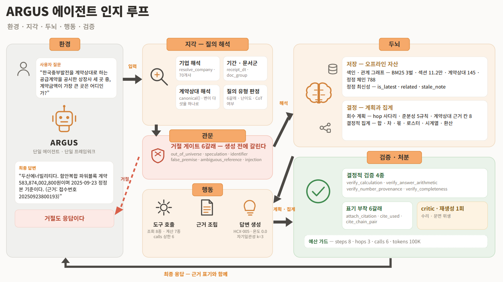

# ARGUS

**공시들 사이의 관계를 읽는 근거 추적형 전자공시 질의응답 서비스**

ARGUS: **A**gentic **R**etrieval and **G**rounded **U**nderstanding of **S**ecurities disclosures

제10회 2026 미래에셋증권 AI Festival · 공시 Agent (Disclosure Analyst)

---

## 목차

1. [개요](#1-개요)
2. [연구개발과제의 필요성](#2-연구개발과제의-필요성)
3. [최종 목표와 단계별 목표](#3-최종-목표와-단계별-목표)
4. [시스템 아키텍처](#4-시스템-아키텍처)
5. [핵심 기술](#5-핵심-기술)
6. [서버 기준 결과물 생성 절차](#6-서버-기준-결과물-생성-절차)
7. [운영 및 배포](#7-운영-및-배포)
8. [참고 문헌](#8-참고-문헌)

---

## 1. 개요

전자공시를 문서 단위가 아니라 관계 단위로 읽게 하는 서비스다. 접수번호 근거를 붙여 답하는
질의응답 엔진(고정 스키마 `GET /answer`)과 계약·정정·거래상대를 한 화면에서 대조하는 열람
서비스를 하나의 산출물로 제공한다.

ARGUS는 개별 문서로 흩어진 전자공시를 정정 이력·계약·거래상대 등 관계 단위로 연결하여
탐색·분석하는 공시정보 서비스다. 질의응답 엔진은 정정 추적, 관계 확장, 수치 집계를 수행하고
DART 접수번호를 근거로 답변하며, 열람 서비스에서는 관련 공시와 관계를 한 화면에서 비교·확인할
수 있다. 두 서비스는 동일한 코드베이스와 전처리 자산을 공유하여 데이터 일관성과 확장성을
확보한다.

```
질의   HD현대일렉트릭이 2023년 1월에 체결한 2500kVA 배전변압기 등 3,500대
       공급계약의 계약금액은 얼마인가?

응답   HD현대일렉트릭이 2023년 1월에 체결한 2500kVA 배전변압기 등 3,500대
       공급계약의 계약금액은 97,000,000,000원(970억 원)입니다.
       (근거: 단일판매ㆍ공급계약체결, 2023-01-31, 접수번호 20230131800162)
```

설계 원칙은 검증 가능한 연산을 언어 모델에 위임하지 않는 것이다. 검색, 정정 이력 추적, 수치
계산, 근거 표기, 안전 처리를 결정적 규칙으로 구현하며, 파이프라인의 대부분이 언어 모델 호출
없이 종료되므로 응답 지연이 낮고 재현성이 높다.

| 구분 | 값 |
|---|---|
| 생성 모델 | HyperCLOVA X (HCX-005), 온도 0.0 |
| 대상 코퍼스 | 상장사 70곳, 2023.01 ~ 2026.03, 공시 4,204건 |
| 배포 구성 | `A92`. 구성 스위치 92개 중 73개 활성 |
| 평가셋 정확도 | 112 · 112 · 112 · 112 / 112 (평가 서버 4회, 회차마다 캐시 없이 재생성) |
| 미공개 문항 정확도 | 52 · 52 · 53 · 51 / 54 (평가 서버 4회) |
| 응답 지연 | 중앙값 10.6초, p95 29.3초, 최대 46.7초. 규약 상한 300초 초과 0건 |
| 자동화 시험 | 2,027건 |

코퍼스 규모는 `data/dart-disclosures/manifest.jsonl`, 구성 스위치는
[`src/argus/ablation.py`](src/argus/ablation.py) 를 따른다. 응답 지연은 서버 3회 336응답
실측이다([`docs/open-issues-v3.md`](docs/open-issues-v3.md) §12.2). 정확도의 회차별 원본은
`scratch/audit/axis_compare.json` 과 `scratch/audit/axis_heldout_A92h.json` 이며, 해당 디렉터리는
저장소에 포함하지 않으므로 [6장](#6-서버-기준-결과물-생성-절차)의 절차로 생성한다.

---

## 2. 연구개발과제의 필요성

전자공시(DART)는 상장기업이 법령에 따라 제출하는 1차 원천 정보로, 계약·투자·지분 변동·정정
등의 정보가 개별 문서 단위로 축적된다. 리서치·심사·감사·IR 업무에서 사실 확인의 출발점이
되는 법정 원천 데이터로서, 요약·가공된 2차 정보와 달리 원문 자체가 주요 근거 자료로 활용된다.

### 2.1 문서 단위 열람의 한계

현재 공시 활용은 키워드 검색과 개별 문서 열람에 의존한다. 그러나 실무 질의의 상당수는 한
문서 안에 답이 존재하지 않는다. 계약상대를 축으로 여러 기업의 공시를 가로로 모으거나, 정정
이력을 세로로 따라가야 비로소 답이 성립한다. 문서 단위 도구는 이러한 관계를 드러내지 못하므로
수작업 대조가 발생하며, 확인 시간이 증가하고 그 과정이 재현되지 않아 검토 결과의 일관성을
보장하기 어렵다.

### 2.2 정정공시가 정답을 바꾸는 구조

하나의 계약이 최초 공시 이후 여러 차례 정정되며 [10], 최신본만 참조하면 변경의 경위를 알 수
없고 원본만 참조하면 이미 폐기된 수치를 사용하게 된다. 현행 도구는 정정본과 원공시를 별개
문서로 나열할 뿐 체인으로 연결하지 않으므로, 낡은 값이 보고서와 평가 모형에 유입되는 위험이
상존한다. 사후 정정이 잦은 대형 계약일수록 금액 규모가 커 실무 영향이 크다.

### 2.3 생성형 AI 적용의 신뢰성 부족

언어모델로 공시를 요약·질의응답하려는 시도가 확대되고 있으나, 출처를 지목하지 않거나 문서에
없는 사실을 생성하는 문제로 규제·감사 대상 업무에 그대로 적용하기 어렵다 [9]. 또한 답할 수
없는 질의를 식별해 거절하는 장치가 없을 경우 그럴듯한 오답이 가장 큰 위험이 되며, 응답 지연이
큰 구조에서는 실시간 확인 흐름에 편입되지 못한다.

### 2.4 핵심 가치

근거 추적 가능성(traceability), 문서 간 관계 추론, 응답 속도, 답변 불가의 식별을 동시에
만족시켜야 하는 융합 영역이다 [11]. 문서 단위 열람의 확인 병목과 관계 누락을 해소하고,
금융기관 및 회계법인의 운영 환경에서 즉시 활용 가능한 엔진과 시스템의 구축을 지향한다.

질의응답 엔진과 열람 서비스가 하나의 프레임워크에서 동일한 자산을 공유하므로 답변과 화면이
어긋나지 않으며, 신규 화면이나 신규 질의 유형이 추가되어도 기반을 재구축할 필요가 없다. 고정
스키마 API 형태이므로 리서치·감사·IR 시스템에 결합 가능하고, 대상 종목·기간·공시 유형의
확대만으로 적용 범위가 확장된다. 공시정보의 디지털 활용 수요는 확대 추세에 있으며 [12],
자동화된 규제 준수와 리스크 관리를 대상으로 하는 RegTech 시장의 성장이 이를 뒷받침한다 [13].

---

## 3. 최종 목표와 단계별 목표

전자공시를 관계 단위로 읽는 실시간 질의응답 엔진과 그 위에서 동작하는 관계 열람 서비스를 단일
프레임워크로 개발한다.

**관계 회수·근거 접지 엔진.** 다단 회수(multi-hop retrieval)와 결정적 집계(deterministic
aggregation)를 결합하여, 단일 문서에 답이 존재하지 않는 질의를 목차 경로·정정 체인·거래상대의
관계 축을 따라 해결하고 산출된 모든 수치에 접수번호 근거를 접지(grounding)하는 고속 질의응답
엔진을 개발한다. 답변 불가 질의를 생성 이전 단계에서 식별·거절하는 구조를 포함하여 근거 없는
진술이 산출되는 경로를 차단한다.

**관계 열람 인터페이스.** 엔진과 동일한 전처리 자산을 공유하는 단일 프레임워크 위에서
계약·정정 이력·거래상대를 한 화면에서 대조하는 열람 인터페이스를 개발한다. 정정 전후를 짝으로
제시하고 추적이 단절된 지점을 은폐 없이 명시하여, 답변과 화면이 구조적으로 일치하는 확인
환경을 확보한다.

### 3.1 1단계 (8~9월): 서버 배포 및 성능 검증

고정 스키마 `GET /answer` 를 공인 IP 엔드포인트로 배포하고 구성요소별 분리 측정으로 최종 구성을
확정한다. 코퍼스 프로파일링으로 설계 전제를 검증하고 검색 방식을 확정하며, 원본 대신 해시가
포함된 전처리 산출물만 배포하여 결과의 재현·검증 가능성을 확보하고 클라우드 인스턴스에 상주
서비스로 구축한다. 구성요소의 단계적 추가와 leave-one-out 실험으로 기여도를 측정한다.

| | 결과물 |
|---|---|
| 1 | 관계 축 기반 다단 회수 엔진 PoC |
| 2 | 고정 스키마 `GET /answer` 엔드포인트를 공인 IP 상주 서비스로 배포한 실증 시스템 |
| 3 | 구성요소별 기여 분리 측정 결과 및 벤치마크 비교 자료 |
| 4 | 2단계 확장을 위한 색인·관계 스키마 설계안 |

벤치마크는 키워드 기반 문서 검색, 단일 단계 어휘 검색(BM25 1-shot), 밀집 벡터 검색, 관계 확장이
없는 다단 검색, 단순 RAG(단일 검색 후 생성), 근거 표기가 없는 요약형 문서 QA, 도구 선택을 모델
자율에 위임한 구성, 정정 체인을 고려하지 않는 최신본 단독 참조 구성의 여덟 가지로 설정한다.
판정 결과는 [5.5](#55-구성-스위치-판정)에 있다.

### 3.2 2단계 (9~10월): 사이트 생성 및 UI 구성

동일한 전처리 산출물 위에 열람 화면을 구축하여 관계 단위 열람을 완성하고, 런타임 API와 DB 없이
빌드 타임 JSON만 사용하는 정적 구조로 배포한다. 랜딩·기업·정정 추적·관계망 화면으로 계약, 정정
이력, 거래상대 관계를 시각화하고 추적 한계를 함께 명시하여, 자료에 존재하지 않는 것과 추적이
단절되어 표시하지 못하는 것을 구분해 제시한다.

질의응답 엔진과 열람 인터페이스가 동일 전처리 자산을 읽도록 데이터 계약을 고정하고, 산출물
목록에 해시를 부여해 배포본의 무결성을 외부에서 검증 가능하도록 구성한다.

| | 결과물 |
|---|---|
| 1 | 관계 열람 웹 인터페이스 |
| 2 | 런타임 API와 DB 없이 동작하는 정적 배포 패키지 |
| 3 | 엔진·인터페이스 통합 프레임워크 및 배포 패키지 |
| 4 | 성능검증 보고서 및 적용 매뉴얼 |

### 3.3 마일스톤

| | 2026-08 | 2026-09 | 2026-10 |
|---|:---:|:---:|:---:|
| **[핵심기술 1] 관계 축 다단 회수 및 근거 접지 엔진** | | | |
| 다단 회수 엔진 개발 및 거래소·주요사항·지분 공시 적용 (PoC) | ● | | |
| 정정 체인·거래상대 관계 축 확장 및 회수 성능 개선 | ● | ● | |
| 결정적 집계·근거 접지·거절 게이트 성능 검증 및 보완 | ● | ● | |
| 공시 Agent 질의응답 API 서버 운영 | | ● | ● |
| **[핵심기술 2] 관계 열람 인터페이스 및 단일 프레임워크 통합** | | | |
| 관계 열람 화면 설계 및 기업·정정 추적 화면 구현 (PoC) | | ● | |
| 관계망·역방향 조회 확장 및 한계 표기 체계 적용 | | ● | ● |
| 엔진·화면 데이터 계약 고정 및 답변·화면 정합성 검증 | | | ● |
| 서비스 제안 및 실시간 서비스 시연 | | | ● |

---

## 4. 시스템 아키텍처



환경에서 유입된 질의를 지각이 해석하고, 관문이 생성 이전에 답변 불가 질의를 분기하며, 두뇌가
오프라인 자산을 조회해 회수 계획과 결정적 집계를 확정하고, 행동이 도구를 호출하고 근거를 조립해
답변을 생성하며, 검증·처분이 생성된 답변을 결정적으로 재검사한 뒤 근거 표기와 함께 환경으로
반환한다. 점선은 거절 경로로, 거절 역시 정규 응답으로 처리된다.

### 4.1 계산과 검증의 코드 이관

검색, 정정 체인 추적, 집계, 수치 검증, 근거 표기, 안전 처리가 모두 결정적 규칙으로 동작한다.
파이프라인의 대부분이 언어 모델 호출 없이 종료되므로 응답 지연이 낮고 재현성이 높다.

### 4.2 기지값의 비위임

합계와 차액을 시스템이 선행 계산하여 근거 첫 줄(`- [결정적 집계] ...`)에 배치하고, 답변이 해당
값을 사용하지 않으면 결정적으로 교정한다. 근거 표기의 접수번호 14자리도 모델이 전사하지 않고
시스템이 부착한다.

### 4.3 답변 불가 질의의 선행 분기

코퍼스 범위 밖, 지목한 보고서 부재, 지시대상 불명, 미래 추정 요구, 개인 식별번호 요구, 프롬프트
주입을 갈래로 구분하여 언어 모델 호출 이전에 한계를 고지하거나 역질의한다.

### 4.4 오프라인 자산

전처리 과정은 언어 모델을 호출하지 않는다. 산출물은 해시로 고정하며 배포본과 개발본의 일치를
확인한다.

| 자산 | 규모 | 용도 |
|---|---|---|
| BM25 색인 3벌 | 거래소공시, 주요사항보고, 지분공시 | 본문 검색 |
| 섹션 색인 | 청크 157,397, 어휘 917,779, 포스팅 29,955,181 | 정기공시 목차 경로 탐색 |
| 계약상대 그래프 | 노드 145, 짝 44, 허브(2 이상 파트너) 25 | 발주처 2-hop 관계 |
| 공시 간 참조 | 2,041건 중 910건 해소 | 정정 체인, 관련 공시 |
| 정기공시 체인 | 159건 중 157건 연결 | 사업보고서 연도 연결 |

---

## 5. 핵심 기술

대괄호 번호는 [8장 참고 문헌](#8-참고-문헌)을 가리킨다.

### 5.1 관계 축을 따라가는 다단 회수

단일 문서 검색·생성 구조로는 답이 성립하지 않는 질의를 목차 경로, 정정 체인, 거래상대의 세 관계
축을 따라 후보 집합을 단계적으로 확장하며 해결한다. 좁은 조건에서 출발해 기간 조건을 완화하고
기업 축만 남긴 뒤 전역으로 확대하는 계단형 회수(hop ladder), 정정본에서 원공시로 역방향
이동하는 체인 탐색, 계약상대 노드를 경유해 서로 다른 기업의 공시를 가로로 결합하는 2-hop 확장을
결합한다.

각 단계의 종료 시점에 후보의 충분성을 결정적 규칙으로 판정한다. 충분하면 해당 단계에서 종료하고,
부족하면 다음 단계로 확대하며, 체인이 닫히지 않으면 재검색 대상이 아니라고 판정하여 잔여 단계를
소비하지 않는다. 이로써 얕은 검색(shallow retrieval)과 과잉 탐색(over-thinking)이라는 한 쌍의
실패 모드 [7]를 함께 차단하고 재현성과 응답 속도를 동시에 확보한다.

공시에는 원공시와 정정본, 계약 체결과 해지처럼 표면 유사도가 높으나 의미가 반대인 문서가
구조적으로 존재한다. 선행 연구는 질의 인식 랭커를 범용 임베딩 코사인 유사도로 대체할 때 상대 EM
19.4% 하락이라는 최대 폭의 성능 저하를 보고한다 [6]. 범용 임베딩 유사도가 아니라 질의에서 도출한
관계 축과 결정적 조건으로 후보를 분별하는 설계의 근거가 여기에 있다.

구현은 네 경로를 병행한다.

| 경로 | 대상 | 용도 |
|---|---|---|
| 메타 필터 | 기업명, 접수일, 공시 종류 | 후보 축소 |
| BM25 색인 | 거래소공시, 주요사항보고, 지분공시 | 본문 검색 |
| 섹션 색인 | 정기공시 목차 경로 | 사업보고서 내부 탐색 |
| 계약상대 그래프 | 발주처 2-hop 관계 | 문서 간 열거 |

hop 사다리는 `narrow`, `relax_period`, `corp_only`, `global` 의 네 단계이며 단계별 깊이는
`TOP_K = (5, 8, 10, 10)` 이다([`src/argus/agent/query.py`](src/argus/agent/query.py)). 각 단계의
종료 시점에 `_sufficiency` 가 판정하고 통과 시 즉시 종료한다
([`src/argus/agent/pipeline.py`](src/argus/agent/pipeline.py)).

검색과 추론을 교차하는 다단계 구조는 ReAct [3]에서 도입하되 행동 선택 방식이 다르다. 매 hop을
언어 모델이 선택하지 않고 `plan_section_hops` 가 생성한 결정적 계획이 결정한다.

공시 간 참조 관계는 사전에 추출하여 그래프로 보관한다. 정정본에서 원공시로 거슬러 올라가는
역방향 탐색과 원공시에서 후속 공시로 내려가는 순방향 탐색을 모두 지원하며, 정정 이력 질의는 체인
전체의 금액 변화를 접수일 순으로 근거에 수록한다. 정정공시 체인은 국내 공시 제도의 구조에서
도출한 것으로 별도의 참조 문헌이 없다. 사전 구축 그래프의 불완전성을 질의 시점에 보완하는 처방
[6]과는 방향이 반대이며, 참조 관계가 원문에 명시되어 있으므로 사전 추출이 가능하다.

### 5.2 근거 결합을 생성 이전에 확정하는 결정적 집계

선행 진단 연구는 골든 근거를 그대로 제공한 통제 조건에서도 근거 유형에 따라 성능이 크게 갈리며,
특히 복수 근거를 결합해야 하는 질의에서 구조적으로 붕괴함을 보고한다 [8]. GPT-4o 기준 단일
텍스트 근거 92.76에서 다중 근거 결합 56.26으로 하락하고, 모델별 근거 유형 간 격차는 22.83에서
46.63점에 이른다. 또한 지도 미세조정으로도 교정되지 않으며(한 설정에서 교차 문단 결합이 −23.73
으로 저하) 저자들은 이를 structural limitation 으로 결론짓는다.

본 시스템은 이 진단을 처방으로 전환한다. 근거의 결합, 합계, 차액, 구성 표 검산, 정정 전후 대조를
생성 이전 단계에서 결정적으로 확정하고 항목의 신원(출처, 금액)과 함께 제시하며, 생성 이후에는
답변의 산술 정합성과 근거 전사 정합성을 재검증하여 불일치를 교정한다. 후자는 다중 근거 결합
실패의 실제 양상을 겨냥한 것으로, 답변이 근거 내 다른 항목에서 값을 전사한 경우 결정적 집계가
확정한 값으로 복원한다. 이때 결정적 줄이 명시한 시점을 앵커로 삼고 근거에 실재하는 값만 교체하며
답변이 자체 유도한 값은 변경하지 않아, 교정이 근거의 범위를 초과하지 않도록 제한한다. 즉 모델이
구조적으로 취약한 연산을 모델에 요구하지 않는 구조가 핵심이다.

합계, 차액, 평균은 근거 레코드의 금액 필드를 직접 읽어 시스템이 계산하고 결과를 근거 첫 줄에
배치한다. 계산 조건이 유일하게 결정되지 않으면 어떤 값도 수록하지 않는다.

생성된 답변에는 결정적 검증 네 가지를 적용한다.

| 검증 | 확인 대상 |
|---|---|
| `verify_calculation` | 답변의 계산 결과가 근거와 일치하는가 |
| `verify_answer_arithmetic` | 답변에 제시된 수식이 성립하는가 |
| `verify_number_provenance` | 답변의 수치가 근거에 존재하는가 |
| `verify_completeness` | 필요한 근거가 누락되지 않았는가 |

검증 실패 시 각주 부착, 재계산값 치환, 1회 재생성, 근거 표기 부착, 단위 환산 교정, 반올림 복원,
결과값 보완, 근거에 없는 총액 삭제, 시계열 금액 재정렬 중 해당하는 처분을 적용한다. 모두 결정적
규칙이며 언어 모델을 호출하지 않는다.

계산을 언어 모델 외부로 이관하는 방식은 Chain-of-Thought 부록 B [1]의 외부 계산기에서 도출했다.
Toolformer [4]는 동일한 문제를 모델의 자율적 도구 호출로 해결하나, 호출 시점과 인자를 모델이
결정하는 순간 검증 불가능한 자유도가 증가한다.

### 5.3 회수와 생성을 분리하는 통제형 검증체계

동일 연구 [8]의 방법론적 기여는 검색 오류를 제거한 통제 실험(데이터셋이 제공한 골든 근거만
투입)으로 근거 활용 능력 자체를 분리 계측한 점이며, 평가 신뢰도를 위해 판정을 반복 수행하고
표준편차를 함께 보고한다. 또한 시스템 프롬프트 토큰이 문서 이미지 근거 토큰보다 큰 비중의 주의를
배분받는다는 관측을 제시한다. 본 시스템은 이를 다음 세 가지로 내재화한다.

**진단 구성과 배포 구성의 분리.** 골든 근거를 주입하는 `golden_oracle` 스위치를 별도 팔
(`ORACLE`)로 두어 생성 단계의 실패를 회수 실패와 분리하여 관측한다. 두 조건은 투입 근거의 규모가
상이하므로 그 차이값을 회수 기여분으로 환산하지 않고 진단 목적에 한정하여 해석한다. 해당 팔은
`DIAGNOSTIC_ARMS` 에 등록되어 성적으로 인용되지 않는다.

**복수 회차 판정.** 회차별 성적과 회차 간 실패 문항의 합집합·교집합을 함께 보고하여 상시 실패와
회차 의존 실패를 구분한다. 절차는 [6장](#6-서버-기준-결과물-생성-절차)에 있다.

**상시 프롬프트 규칙의 최소화.** 기본 규칙을 7개로 제한하고 단위, 비교, 연결, 거절 등 특수 규칙은
질의가 요구할 때만 조건부로 부착한다([`src/argus/agent/prompts.py`](src/argus/agent/prompts.py)).

이로써 성능 변화가 회수, 집계, 생성 중 어느 단계에서 발생했는지 구성요소별로 귀속 가능한 측정
체계를 갖춘다. 요소마다 스위치를 두어 누적 추가 사다리와 leave-one-out 으로 각 요소의 기여를
개별 측정한다([`src/argus/ablation.py`](src/argus/ablation.py), 팔 112개).

### 5.4 안전 처리와 거절

답변 불가 질의를 여섯 갈래로 분류하여 생성 이전에 처리한다.

| 갈래 | 대응 |
|---|---|
| `out_of_universe` | 대상 범위를 명시하고 한계 고지 |
| `ambiguous_reference` | 대상 기업 역질의 |
| `speculation` | 미래 추정이 공시 기재사항이 아님을 고지 |
| `identifier` | 개인 식별번호 제공 불가 고지 |
| `false_premise` | 질의 전제가 공시와 상충함을 고지 |
| `injection` | 지시 주입 및 미공개 정보 요구 차단 |

기간 범위 밖(`out_of_range`)과 지목한 보고서 부재(`no_such_report`)는 라우터의 범위 검사에서 동일
경로로 처리한다. 각 갈래는 두 신호의 곱집합으로만 발화한다. 단일 신호 판정은 정상 질의를
거절시키기 때문이며, 평가셋 112문항 전수에서 오탐 0건을 확인했다.

개인정보 마스킹은 별도 계층으로 동작한다. 질의에 포함된 주민등록번호와 연락처는 응답에 노출되지
않으며, 법인등록번호와 같이 공시에 정당하게 기재된 식별번호는 보존한다. 갈래를 단일 게이트로
통합하지 않은 것은 한계의 종류에 따라 고지가 달라야 하고, 통합 시 각 갈래의 기여를 귀속할 수 없기
때문이다.

### 5.5 구성 스위치 판정

처방마다 구성 스위치를 세워 본 코퍼스에서 측정하고 그 결과로 채택 여부를 결정했다. 기각 역시
측정 결과이므로 함께 기록한다. 측정 절차는
[`docs/pipeline/09-ablation.md`](docs/pipeline/09-ablation.md), 스위치 정의는
[`src/argus/ablation.py`](src/argus/ablation.py) 에 있다.

| 처방 | 실측 | 판정 | 스위치 |
|---|---|---|---|
| Chain-of-Thought 부록 B [1]. 생성된 등식을 외부 계산기로 재계산하고 결과를 전파 | 답변 내부 산술 정합성 교정에 기여 | 채택 | `verify_answer_arithmetic`, `substitute_verified`, `regenerate_on_verify` |
| ReAct [3]. 검색과 추론을 교차하는 다단계 루프 | hop 사다리로 구현. 행동 선택은 결정적 계획이 담당 | 채택(변형) | `hop_ladder` |
| GraphRAG-R1 [7]. 얕은 검색과 과잉 탐색의 동시 억제 | 매 hop 종료 시 충분성 판정과 예산 가드(steps 8, hops 3, calls 6, tokens 100K)로 구현. 보상 학습은 미사용 | 채택(변형) | `_sufficiency`, `budget` |
| Relink [6]. 범용 임베딩 유사도의 한계 | 본문 검색을 BM25로 두고 관계 축과 결정적 조건으로 분별하는 근거. 질의 시점 그래프 구성은 미구현 | 설계 근거 | 해당 없음 |
| Diagnosing Evidence Utilization [8]. 골든 근거 주입 통제 실험 | 근거 이용률의 분리 측정 설계로 내재화 | 채택 | `golden_oracle` |
| Self-Consistency [2]. k개 표본의 다수결 | 원형(온도 0.7)은 밸류체인 5/12로 기준 6/12 미달. 온도 0.0 변형은 금액 문항 한정 발화로 배포 구성에 포함 | 원형 기각, 변형 채택 | `temperature`, `sc_k`, `sc_figures_only`, `sc_key_set` |
| Toolformer [4]. 산술을 모델의 도구 호출에 위임 | 전체 74/88으로 기준 81/88 미달 | 기각 | `function_calling` |
| HyperGraphRAG [5]. n-ary 관계를 하이퍼엣지로 표현 | 코퍼스의 arity 2 이하가 58.4%로 과반이어서 논문의 전제가 불성립. 전체 81/88, 밸류체인 6/12로 기준과 동일 | 기각 | `nary` |
| 임베딩 하이브리드. `bge-m3` 임베딩 검색을 BM25와 RRF로 융합 | 검색 단계 델타 0, 밸류체인 7/12로 최종 10/12 미달 | 기각 | `dense` |

운영 경로에서 임베딩 API를 호출하지 않으며, 기각된 스위치는 저장소에 보존되어 재현 가능하다.

---

## 6. 서버 기준 결과물 생성 절차

배포된 서버에서 본 저장소의 성적표를 처음부터 재생성하는 절차다. 로컬 실행이 아니라 공인 IP에
상주하는 서비스에 실제로 질의하여 산출물을 생성하며, 평가자가 수행하는 경로와 동일하다.

### 6.0 전제

[7.2 환경 구성](#72-환경-구성)의 `artifacts/` 와 `data/` 를 저장소 루트에 배치하고, HyperCLOVA X
자격증명을 담은 `.env` 를 준비한다. 파이썬 3.12 이상에서 `pip install -e ".[dev]"` 로 설치한다.

### 6.1 구성 고정

서버가 사용할 구성은 다음 한 줄이 결정한다.

```python
# src/argus/ablation.py
_current: Arm = A92
```

배포본은 `A92` 다. 이 값을 변경하여 재배포하면 다른 구성이 동작하므로 이전 회차와 병렬 비교할 수
없다. 팔의 계보와 각 팔의 변경 내용은 동일 파일의 주석에 기록되어 있다.

### 6.2 배포

절차의 정본은 [`deploy/README.md`](deploy/README.md) 에 있다.

```bash
scp -r . root@<IP>:/opt/argus
ssh root@<IP> 'bash /opt/argus/deploy/setup.sh'
scp .env root@<IP>:/opt/argus/.env
scp -r artifacts root@<IP>:/opt/argus/
ssh root@<IP> 'cp /opt/argus/deploy/argus.service /etc/systemd/system/ && \
  systemctl daemon-reload && systemctl enable --now argus'
```

다섯 키 JSON이 반환되면 정상이다.

```bash
curl -s "http://<IP>/answer?question_id=Q-001&question=테스트"
```

### 6.3 회차 수집

생성은 표집이므로 1회 실행은 1개 표본에 해당한다. 따라서 회차를 분리하여 복수 수집한다.

```bash
# 골든셋 계열 (88 + 12 + 12 문항)
PYTHONIOENCODING=utf-8 python scripts/server_sweep.py 223.130.129.131 \
    --arm A92 --round 4 full safety valuechain

# 미공개셋 계열 (18 + 16 + 20 = 54 문항)
PYTHONIOENCODING=utf-8 python scripts/server_sweep.py 223.130.129.131 \
    --arm A92h --round 4 heldout_v2 heldout_v3 newset
```

`--round N` 은 회차별 디렉터리에 기록한다(1회차는 접미 없음, 이후 `_r2`, `_r3`, `_r4`). 미공개셋은
팔 이름에 `h` 를 부여하여 골든셋 산출물과 분리한다. 코호트당 두 종의 산출물이 생성된다.

```
scratch/ablation/v6/server_<코호트>[_rN]/<팔>/responses/<qid>.json   러너의 채점 대상 형식
eval_server/<코호트>[_rN].json                                       다섯 키 답변. 러너 없이 열람
```

요청은 순차적이며 간격을 둔다. 상류에 분당 요청 한도가 있어 초과 시 답변 대신 한계 고지가
반환되어 오답으로 계수되기 때문이며, 해당 표식이 부착된 응답은 대기를 확대하여 자동 재시도한다.

### 6.4 채점

채점 규칙을 재구현하지 않고, 저장된 응답을 러너의 채점 경로로 재입력한다. 닫힌 문항은
`score_closed`, 열린 문항은 언어 모델 판정기를 경유한다.

```bash
# 골든셋
PYTHONIOENCODING=utf-8 python scripts/score_server.py --arm A92 --rounds 4

# 미공개셋
PYTHONIOENCODING=utf-8 python scripts/score_heldout_rounds.py --arm A92h --rounds 4
```

### 6.5 아홉 축 분해

정확성, 근거 완전성, 요구사항 충족, 근거 기반, 추론 논리성, 안전성·신뢰성, 정보한계 대응, 근거
표시(골든 일치), 근거 표시(표기 유무)의 아홉 축으로 실패를 분해하여 문항 ID를 기록한다. 서버를
재호출하지 않고 기수집 응답을 재입력한다.

```bash
PYTHONIOENCODING=utf-8 python scripts/axis_compare.py               # 골든셋
PYTHONIOENCODING=utf-8 python scripts/axis_heldout.py --arm A92h    # 미공개셋
```

산출물은 `scratch/audit/axis_compare.json` 과 `scratch/audit/axis_heldout_A92h.json` 이다.
`scratch/` 는 `.gitignore` 대상이므로 위 명령으로 생성한다. 성적 인용 시 요약본이 아니라 이
파일을 참조한다.

### 6.6 결과 해석

**단일 세트의 3회로 구성을 비교하지 않는다.** 상류는 온도 0에서도 결정적이지 않다. 프롬프트가
바이트 단위로 동일한 두 실행에서 답변 문면이 43~48% 상이하고, 금액과 비율까지 상이한 문항이
34%다. 동일 구성을 두 세트 수집하여 이를 확인했다.

**회차별 성적과 합집합·교집합을 병행 검토한다.** 전 회차에서 오답인 문항(교집합)은 상시 실패이며
구성 개선의 대상이다. 단일 회차에서만 오답인 문항은 회차 의존 실패이며, 해당 문항을 겨냥한 수정은
후속 회차가 그 효과를 입증하지 못한다.

**미공개셋의 근거 완전성 분모는 골든셋과 상이하다.** 미공개 54문항에는 필수·선택 주석이 없어 골든
근거 전량을 필수로 계수한다. 골든셋의 168칸과 직접 비교할 수 없다.

**`ORACLE` 팔의 수치는 성적이 아니다.** 평가 시점에 재현 불가능한 정보를 사용하므로 제출 구성이
될 수 없으며, 러너가 표와 함께 경고를 출력한다.

---

## 7. 운영 및 배포

### 7.1 평가용 API

```
GET http://223.130.129.131/answer?question_id={id}&question={질의}
```

공인 IP 직접 접근, HTTP 표준 포트 80, 인증 헤더 없음.

```json
{
  "question_id": "Q-001",
  "question": "평가 질의 원문",
  "retrieved_context": "답변 생성에 참고한 검색 문서",
  "think_trace": "사고, 추론, 도구 사용 과정",
  "answer": "최종 생성 답변"
}
```

다섯 필드 모두 문자열이며 `Content-Type: application/json` 으로 반환된다.

| 항목 | 값 |
|---|---|
| 응답 시간 | 중앙값 10.6초, p95 29.3초, 최대 46.7초 (규약 상한 300초, 초과 0건) |
| 오류 응답 | 없음. 내부 장애를 포함한 모든 경우에 200과 한계 고지를 반환 |
| 동시성 | 순차 호출 1건 기준 |
| 운영 기간 | 2026-09-07 부터 2026-09-20 까지 전 기간 가동 |

5xx를 반환하지 않는 것은 설계 선택이다. 규약상 타임아웃과 5xx는 최대 2회 재시도되고 3회 모두
실패하면 해당 문항이 0점 처리되므로, 상류 장애 시에도 스키마를 준수한 한계 고지를 반환하는 편이
안전하다.

```python
import requests

resp = requests.get(
    "http://223.130.129.131/answer",
    params={"question_id": "Q-001", "question": "평가 질의"},
    timeout=300,
)
result = resp.json()
```

### 7.2 환경 구성

파이썬 3.12 이상. 의존성은 `requirements.txt` 에 고정되어 있으며, 평가 서버에서 구동 중인
환경(파이썬 3.12.3)과 일치한다.

```bash
git clone <repository>
cd ARGUS
pip install -r requirements.txt
```

전처리 산출물과 코퍼스 대장은 용량 문제로 저장소에 포함하지 않았다. 아래에서 내려받아 저장소
루트에 배치한다.

| 묶음 | 용량 | 내용 |
|---|---|---|
| artifacts | 1.2GB | 색인, 정형 레코드, 계약상대 그래프 |
| data | 5.2GB | 원본 공시, 문서 대장, 기업 목록 |

```
artifacts   https://drive.google.com/file/d/12NBmEUjV1t5o3BbJK16z6rptESr9gbUH/view?usp=sharing
data        https://drive.google.com/drive/folders/1IPNdXxBFVXq3dSCyARAzD_m1fiEOZIsJ?usp=sharing
```

`data/dart-disclosures/manifest.jsonl` 과 `universe.csv` 가 없으면 라우터가 대상 기업 70곳을
읽지 못해 모든 질의가 범위 밖으로 처리되므로 반드시 함께 배치한다.

무결성 대조표는 `deploy/preprocessing_manifest.json` 에 있다. 파일 20개의 SHA256과 바이트 수를
수록하며 기준일은 2026-08-20이다.

```bash
python scripts/build_preprocessing_manifest.py --check
```

### 7.3 실행

```bash
# API 서버
python -m uvicorn argus.api.server:app --host 0.0.0.0 --port 8000
# 평가 서버는 systemd 로 포트 80에서 구동한다. deploy/README.md 참고

# 테스트
pip install -e ".[dev]"
python -m pytest -q
```

### 7.4 전처리 재실행

전처리 산출물을 직접 생성하려면 아래를 순서대로 실행한다. 언어 모델을 호출하지 않는다.

```bash
python scripts/build_index.py --group exchange   # 거래소공시 레코드와 BM25
python scripts/build_index.py --group major      # 주요사항보고
python scripts/build_index.py --group holding    # 지분공시
python scripts/build_sections.py                 # 정기공시 섹션 색인
python scripts/build_periodic_chains.py          # 정기공시 연도 체인
python scripts/build_counterparty_graph.py       # 계약상대 2-hop 그래프
python scripts/build_nary.py                     # 규칙이 놓친 관계 보강
```

---

## 8. 참고 문헌

기술제안서가 인용한 문헌 전체를 수록한다.

**학술 문헌**

1. Wei, J., Wang, X., Schuurmans, D. et al. Chain-of-Thought Prompting Elicits Reasoning in Large Language Models. NeurIPS 2022. arXiv:2201.11903
2. Wang, X., Wei, J., Schuurmans, D. et al. Self-Consistency Improves Chain of Thought Reasoning in Language Models. ICLR 2023. arXiv:2203.11171
3. Yao, S., Zhao, J., Yu, D. et al. ReAct: Synergizing Reasoning and Acting in Language Models. ICLR 2023. arXiv:2210.03629
4. Schick, T., Dwivedi-Yu, J., Dessì, R. et al. Toolformer: Language Models Can Teach Themselves to Use Tools. Meta AI Research, 2023. arXiv:2302.04761
5. Luo, H., E, H., Chen, G. et al. HyperGraphRAG: Retrieval-Augmented Generation via Hypergraph-Structured Knowledge Representation. NeurIPS 2025.
6. Huang, M., Bu, C., He, Y. et al. Relink: Constructing Query-Driven Evidence Graph On-the-Fly for GraphRAG. Proceedings of the AAAI Conference on Artificial Intelligence, Vol. 40, No. 37, 2026.
7. Yu, C., Zhao, K., Li, Y. et al. GraphRAG-R1: Graph Retrieval-Augmented Generation with Process-Constrained Reinforcement Learning. Proceedings of the ACM Web Conference 2026. doi:10.1145/3774904.3792589
8. Basak, D., Bose, D., Goswami, K., Desarkar, M. S. Diagnosing Evidence Utilization in Multimodal Document Question Answering. Proceedings of the 32nd ACM SIGKDD Conference on Knowledge Discovery and Data Mining V.2, 2026. doi:10.1145/3770855.3817956
9. National Institute of Standards and Technology. Artificial Intelligence Risk Management Framework: Generative Artificial Intelligence Profile. NIST AI 600-1, 2024. doi:10.6028/NIST.AI.600-1

**제도 및 시장 자료**

10. 금융감독원. 전자공시시스템(DART) 정정신고서 이용 시 유의사항. https://dart.fss.or.kr/introduction/content4.do
11. 금융위원회. 정부와 금융권이 함께 금융권 AX를 가속화해 나가겠습니다. 보도자료, 2025. https://www.fsc.go.kr/no010101/87142
12. 디지털헬스데일리. 금감원, 영문 DART 2단계 개편 공개. 공시 콘텐츠 확장. https://www.dhdaily.co.kr/news/articleView.html?idxno=22217
13. Grand View Research. Regulatory Technology Market Size, Share and Trends Analysis Report. https://www.grandviewresearch.com/industry-analysis/regulatory-technology-market

---
