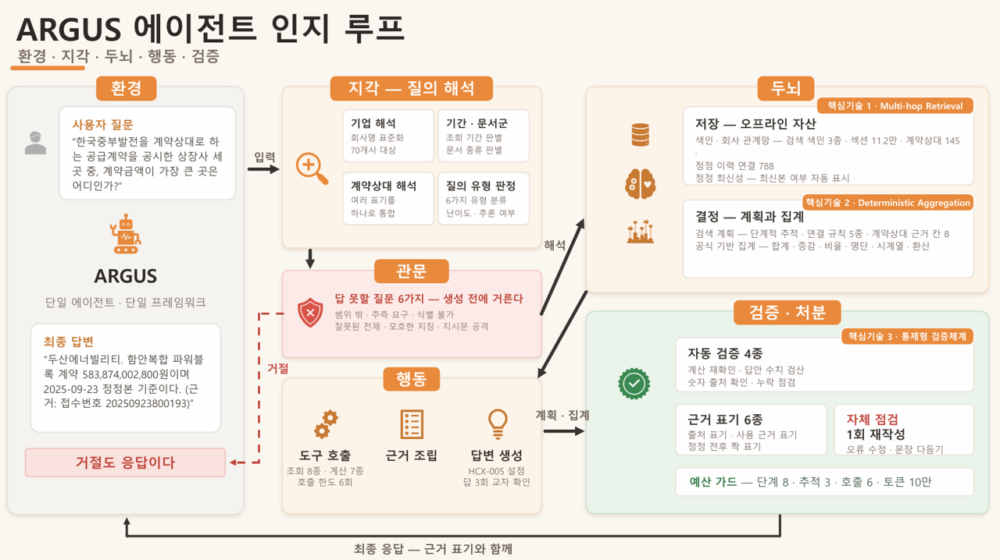

# ARGUS

**공시들 사이의 관계를 읽는 근거 추적형 전자공시 질의응답 서비스**

ARGUS: **A**gentic **R**etrieval and **G**rounded **U**nderstanding of **S**ecurities disclosures


---

## 목차

1. [환경 구성 및 실행](#1-환경-구성-및-실행)
2. [개요](#2-개요)
3. [연구개발과제의 필요성](#3-연구개발과제의-필요성)
4. [최종 목표와 단계별 목표](#4-최종-목표와-단계별-목표)
5. [핵심 기술](#5-핵심-기술)
6. [시스템 아키텍처](#6-시스템-아키텍처)
7. [참고 문헌](#7-참고-문헌)

---

## 1. 환경 구성 및 실행

### 1.1 환경 구성

파이썬 3.12 이상. 의존성은 `requirements.txt` 에 고정되어 있으며, 평가 서버에서 구동 중인
환경(파이썬 3.12.3)과 일치한다.

```bash
git clone https://github.com/JUHWANKIM-ai/ARGUS.git
cd ARGUS
pip install -r requirements.txt
pip install -e . --no-deps
```

`requirements.txt` 는 서드파티 의존성만 고정한다. 소스가 `src` 레이아웃이므로 `argus` 패키지
자체는 두 번째 줄로 설치해야 하며, 생략하면 1.2의 서버 기동이 `ModuleNotFoundError: No module
named 'argus'` 로 실패한다. `--no-deps` 는 첫 줄에서 고정한 판이 덮이지 않게 한다.

생성 단계는 HyperCLOVA X 를 호출한다. 발급 키는 저장소에 넣지 않으므로 루트에 `.env` 를 만들어
채운다. 변수 이름과 용도는 `.env.example` 에 있다.

```bash
cp .env.example .env      # CLOVA_API_KEY 에 발급 키를 채운다
```

| 변수 | 필수 | 용도 |
|---|:---:|---|
| `CLOVA_API_KEY` | ○ | HyperCLOVA X 호출 인증 |
| `CLOVA_TUNED_TASK_ID` | | 튜닝 모델의 training task id. 비우면 기본 모델 `HCX-005` |

키가 없어도 서버는 기동하고 응답 스키마도 지켜지지만, 호출이 401로 떨어져 검색까지만 수행한 뒤
모든 질의가 한계 고지로 반환된다.

전처리 산출물과 코퍼스 대장은 용량 문제로 저장소에 포함하지 않았다. 아래에서 내려받아 저장소
루트에 배치한다.

| 묶음 | 용량 | 내용 |
|---|---|---|
| artifacts | 1.2GB | 색인, 정형 레코드, 계약상대 그래프 |
| data | 5.2GB | 원본 공시, 문서 대장, 기업 목록 |

```
artifacts   https://drive.google.com/file/d/12NBmEUjV1t5o3BbJK16z6rptESr9gbUH/view?usp=sharing
data        https://drive.google.com/drive/folders/1IPNdXxBFVXq3dSCyARAzD_m1fiEOZIsJ?usp=sharing
```

`data/dart-disclosures/` 아래의 `manifest.jsonl` 과 `universe.csv` 가 없으면 라우터가 대상 기업
70곳을 읽지 못해 모든 질의가 범위 밖으로 처리되므로 반드시 함께 배치한다.

### 1.2 실행

```bash
python -m uvicorn argus.api.server:app --host 0.0.0.0 --port 8000
```

기동 후 다섯 키 JSON이 반환되면 정상이다.

```bash
curl -s "http://127.0.0.1:8000/health"
curl -s -G "http://127.0.0.1:8000/answer" \
  --data-urlencode "question_id=Q-001" \
  --data-urlencode "question=테스트"
```

### 1.3 전처리 재실행

배포한 전처리 산출물을 직접 생성하려면 아래를 순서대로 실행한다. 여덟 단계 모두 언어 모델을
호출하지 않으며, 입력은 `data/dart-disclosures/` 의 원본 공시와 문서 대장뿐이다.

```bash
python scripts/build_index.py --group exchange   # 거래소공시 레코드와 본문 색인
python scripts/build_index.py --group major      # 주요사항보고
python scripts/build_index.py --group holding    # 지분공시
python scripts/build_references.py               # 공시 간 참조 관계
python scripts/build_sections.py                 # 정기공시 섹션 본문과 메타
python scripts/build_section_index.py            # 정기공시 섹션 검색 색인
python scripts/build_periodic_chains.py          # 정기공시 연도 체인
python scripts/build_counterparty_graph.py       # 계약상대 그래프
```

단계별 산출물은 다음과 같다. 이 열세 개가 배포 구성이 여는 파일의 전부다.

| 단계 | 산출물 |
|---|---|
| `build_index.py` 세 번 | `{exchange,major,holding}_records.jsonl`, `{exchange,major,holding}_bm25.json` |
| `build_references.py` | `references.jsonl` |
| `build_sections.py` | `periodic_sections.jsonl`, `periodic_sections.txt` |
| `build_section_index.py` | `section_index.npz`, `section_index.json` |
| `build_periodic_chains.py` | `periodic_chains.jsonl` |
| `build_counterparty_graph.py` | `counterparty_graph.json` |

순서에 두 가지 의존이 있다. `build_section_index.py` 는 `build_sections.py` 가 만든
`periodic_sections.jsonl` 과 `periodic_sections.txt` 를 입력으로 읽고,
`build_counterparty_graph.py` 는 `build_index.py --group exchange` 가 만든
`exchange_records.jsonl` 을 읽는다. 나머지 네 단계는 문서 대장만 참조하므로 순서에 자유롭다.

전체 재실행에 206초가 걸린다. 산출물은 결정적이어서 같은 입력에서 다시 만들면 배포본과
바이트 단위로 일치한다. 여덟 단계를 새 환경에서 완주해 산출물 13개의 SHA256 이 평가 서버의
것과 모두 같음을 확인했다. 파일별 SHA256 과 바이트 수는
`deploy/preprocessing_manifest.json` 에 있으며, 재생성본과 배포본의 대조는 이 목록으로
수행한다.

한국어 콘솔에서 실행할 때는 `PYTHONIOENCODING=utf-8` 을 지정한다. 지정하지 않으면
`build_references.py` 가 산출물을 기록한 뒤 진행 로그를 출력하는 지점에서
`UnicodeEncodeError` 로 종료한다. 산출물 자체는 영향을 받지 않는다.

### 1.4 평가용 API

제출 항목의 **엔드포인트 URL 과 API 명세서**에 해당한다.

```
GET http://223.130.129.131/answer
```

공인 IP 직접 접근, HTTP 표준 포트 80, 인증 헤더 없음.

**요청.** 질의 문자열은 URL 인코딩한다.

| 파라미터 | 위치 | 타입 | 필수 | 설명 |
|---|---|---|:---:|---|
| `question_id` | query | string | ○ | 평가 문항 식별자. 응답에 그대로 반향한다 |
| `question` | query | string | ○ | 평가 질의 원문 |

두 파라미터가 빠져도 422를 내지 않는다. 빠진 값을 빈 문자열로 채우고 200과 다섯 키를 반환하며,
`question` 만 있으면 그것만으로 답한다.

**응답.** `Content-Type: application/json`. 다섯 필드 모두 문자열이며 어떤 경우에도 누락되지
않는다.

| 필드 | 타입 | 설명 |
|---|---|---|
| `question_id` | string | 요청의 `question_id` 를 그대로 반향 |
| `question` | string | 요청의 `question` 을 그대로 반향 |
| `retrieved_context` | string | 답변 생성에 참고한 검색 문서 |
| `think_trace` | string | 사고, 추론, 도구 사용 과정 |
| `answer` | string | 최종 생성 답변 |

```json
{
  "question_id": "Q-001",
  "question": "평가 질의 원문",
  "retrieved_context": "답변 생성에 참고한 검색 문서",
  "think_trace": "사고, 추론, 도구 사용 과정",
  "answer": "최종 생성 답변"
}
```

| 항목 | 값 |
|---|---|
| 응답 시간 | 중앙값 10.6초, p95 29.3초, 최대 46.7초 (규약 상한 300초, 초과 0건) |
| 오류 응답 | 없음. 내부 장애를 포함한 모든 경우에 200과 한계 고지를 반환 |
| 동시성 | 순차 호출 1건 기준 |
| 운영 기간 | 2026-09-07 부터 2026-09-20 까지 전 기간 가동 |

5xx를 반환하지 않는 것은 설계 선택이다. 규약상 타임아웃과 5xx는 최대 2회 재시도되고 3회 모두
실패하면 해당 문항이 0점 처리되므로, 상류 장애 시에도 스키마를 준수한 한계 고지를 반환하는 편이
안전하다.

호출 예시는 아래와 같다.

```bash
curl -s -G "http://223.130.129.131/answer" \
  --data-urlencode "question_id=Q-001" \
  --data-urlencode "question=평가 질의"
```

```python
import requests

resp = requests.get(
    "http://223.130.129.131/answer",
    params={"question_id": "Q-001", "question": "평가 질의"},
    timeout=300,
)
result = resp.json()
```

### 1.5 예시 질의 실행

`examples/questions_all.json` 에 평가셋과 미공개 문항을 합한 166건이 있다.
`examples/test.py` 가 이를 순서대로 API에 던지고 응답 다섯 키를 `examples/answers.json` 에
기록한다. 표준 라이브러리만 사용하므로 위 1.1의 `pip install` 외에 준비할 것이 없으며, 채점은
수행하지 않는다. 저장소 루트에서 실행한다.

```bash
python examples/test.py                            # 배포 서버로 166건
python examples/test.py --host 127.0.0.1:8000      # 1.2로 띄운 로컬 서버로 166건
```

문항은 다섯 트랙으로 나뉜다.

| 트랙 | 문항 | 검증 대상 |
|---|:---:|---|
| `grid` | 110 | 단일 문서 추출, 정정 체인 추적, 두 기업 대조, 복합 추론 |
| `valuechain` | 18 | 계약상대를 축으로 한 기업 간 연결 |
| `safety` | 17 | 지시 주입과 개인 식별번호 요구의 차단 |
| `info_limit` | 11 | 자료에 없는 질의의 거절 |
| `regression` | 10 | 과거에 실패했던 문항의 재발 여부 |

코호트로는 평가셋 112건과 미공개 문항 54건이다.

저장소에 포함된 `examples/answers.json` 은 2026-09-01 배포 서버 실측 결과다. 166건 전부 200과
다섯 키를 반환했고 실패와 키 결손은 없었다.

| 항목 | 값 |
|---|---|
| 소요 시간 | 중앙값 9.2초, 평균 10.7초, p95 25.4초, 최대 38.6초 |
| `grid` | 중앙값 11.2초 |
| `valuechain` | 중앙값 16.9초 |
| `regression` | 중앙값 9.4초 |
| `safety`, `info_limit` | 중앙값 0.0초 |

거절 트랙의 소요가 0초인 것은 6.1의 거절 관문이 언어 모델 호출 이전에 종료하기 때문이다.

---

## 2. 개요

전자공시를 문서 단위가 아니라 관계 단위로 읽게 하는 서비스다. 접수번호 근거를 붙여 답하는
질의응답 엔진(고정 스키마 `GET /answer`)과 계약·정정·거래상대를 한 화면에서 대조하는 열람
서비스를 하나의 산출물로 제공한다.

ARGUS는 개별 문서로 흩어진 전자공시를 정정 이력·계약·거래상대 등 관계 단위로 연결하여
탐색·분석하는 공시정보 서비스다. 질의응답 엔진은 정정 추적, 관계 확장, 수치 집계를 수행하고
DART 접수번호를 근거로 답변하며, 열람 서비스에서는 관련 공시와 관계를 한 화면에서 비교·확인할
수 있다. 두 서비스는 동일한 코드베이스와 전처리 자산을 공유하여 데이터 일관성과 확장성을
확보한다.

```
질의   HD현대일렉트릭이 2023년 1월에 체결한 2500kVA 배전변압기 등 3,500대
       공급계약의 계약금액은 얼마인가?

응답   HD현대일렉트릭이 2023년 1월에 체결한 2500kVA 배전변압기 등 3,500대
       공급계약의 계약금액은 97,000,000,000원(970억 원)입니다.
       (근거: 단일판매ㆍ공급계약체결, 2023-01-31, 접수번호 20230131800162)
```

설계 원칙은 검증 가능한 연산을 언어 모델에 위임하지 않는 것이다. 검색, 정정 이력 추적, 수치
계산, 근거 표기, 안전 처리를 결정적 규칙으로 구현하며, 파이프라인의 대부분이 언어 모델 호출
없이 종료되므로 응답 지연이 낮고 재현성이 높다.

| 구분 | 값 |
|---|---|
| 생성 모델 | HyperCLOVA X (HCX-005), 온도 0.0 |
| 대상 코퍼스 | 상장사 70곳, 2023.01 ~ 2026.03, 공시 4,204건 |
| 응답 지연 | 중앙값 10.6초, p95 29.3초, 최대 46.7초. 규약 상한 300초 초과 0건 |

코퍼스 규모는 `data/dart-disclosures/manifest.jsonl`, 구성 스위치는
[`src/argus/ablation.py`](src/argus/ablation.py) 를 따른다. 응답 지연은 서버 3회 336응답
실측이다.

---

## 3. 연구개발과제의 필요성

전자공시(DART)는 상장기업이 법령에 따라 제출하는 1차 원천 정보로, 계약·투자·지분 변동·정정
등의 정보가 개별 문서 단위로 축적된다. 리서치·심사·감사·IR 업무에서 사실 확인의 출발점이
되는 법정 원천 데이터로서, 요약·가공된 2차 정보와 달리 원문 자체가 주요 근거 자료로 활용된다.

아래 세 한계는 각각 5장의 핵심 기술과 6장의 아키텍처 구성요소로 대응한다. 대응 관계는 3.4에
정리한다.

### 3.1 문서 단위 열람의 한계

현재 공시 활용은 키워드 검색과 개별 문서 열람에 의존한다. 그러나 실무 질의의 상당수는 한
문서 안에 답이 존재하지 않는다. 계약상대를 축으로 여러 기업의 공시를 가로로 모으거나, 정정
이력을 세로로 따라가야 비로소 답이 성립한다. 문서 단위 도구는 이러한 관계를 드러내지 못하므로
수작업 대조가 발생하며, 확인 시간이 증가하고 그 과정이 재현되지 않아 검토 결과의 일관성을
보장하기 어렵다.

관계를 축으로 후보를 넓혀 가는 회수가 필요하다. 5.1의 관계 기반 다단 회수가 이에 대응한다.

### 3.2 정정공시가 정답을 바꾸는 구조

하나의 계약이 최초 공시 이후 여러 차례 정정되며 [4], 최신본만 참조하면 변경의 경위를 알 수
없고 원본만 참조하면 이미 폐기된 수치를 사용하게 된다. 현행 도구는 정정본과 원공시를 별개
문서로 나열할 뿐 체인으로 연결하지 않으므로, 낡은 값이 보고서와 평가 모형에 유입되는 위험이
상존한다. 사후 정정이 잦은 대형 계약일수록 금액 규모가 커 실무 영향이 크다.

정정본에서 원공시로 거슬러 오르는 체인 회수와, 정정 전후 금액을 생성 이전에 확정하는 집계가
함께 필요하다. 5.1의 체인 회수와 5.2의 결정적 집계가 이에 대응한다.

### 3.3 생성형 AI 적용의 신뢰성 부족

언어모델로 공시를 요약·질의응답하려는 시도가 확대되고 있으나, 출처를 지목하지 않거나 문서에
없는 사실을 생성하는 문제로 규제·감사 대상 업무에 그대로 적용하기 어렵다 [3]. 또한 답할 수
없는 질의를 식별해 거절하는 장치가 없을 경우 그럴듯한 오답이 가장 큰 위험이 되며, 응답 지연이
큰 구조에서는 실시간 확인 흐름에 편입되지 못한다.

이 한계는 세 갈래로 나뉜다. 근거 없는 수치는 5.2의 결정적 집계와 생성 이후 검증이 막고, 오류가
회수와 집계와 생성 중 어디에서 났는지는 5.3의 통제형 검증체계가 가른다. 답할 수 없는 질의
자체는 6.1의 거절 관문이 생성 이전에 분기한다.

### 3.4 핵심 가치와 대응 구조

근거 추적 가능성(traceability), 문서 간 관계 추론, 응답 속도, 답변 불가의 식별을 동시에
만족시켜야 하는 융합 영역이다 [5]. 각 요구는 다음과 같이 대응한다.

| 요구 | 대응 |
|---|---|
| 문서 간 관계 추론 | 5.1 관계 기반 다단 회수 |
| 근거 추적 가능성 | 5.2 생성 전 결정적 근거 결합 및 집계 |
| 신뢰성의 단계별 귀속 | 5.3 통제형 검증체계 |
| 답변 불가의 식별 | 6.1 거절 관문 |
| 응답 속도 | 6.2 오프라인 자산과 언어 모델 호출의 최소화 |

문서 단위 열람의 확인 병목과 관계 누락을 해소하고, 금융기관 및 회계법인의 운영 환경에서 즉시
활용 가능한 엔진과 시스템의 구축을 지향한다.

질의응답 엔진과 열람 서비스가 하나의 프레임워크에서 동일한 자산을 공유하므로 답변과 화면이
어긋나지 않으며, 신규 화면이나 신규 질의 유형이 추가되어도 기반을 재구축할 필요가 없다. 고정
스키마 API 형태이므로 리서치·감사·IR 시스템에 결합 가능하고, 대상 종목·기간·공시 유형의
확대만으로 적용 범위가 확장된다. 공시정보의 디지털 활용 수요는 확대 추세에 있으며 [6],
자동화된 규제 준수와 리스크 관리를 대상으로 하는 RegTech 시장의 성장이 이를 뒷받침한다 [7].

## 4. 핵심 기술

기술제안서가 세운 핵심 기술 세 가지를 구현으로 옮긴 것이다. 세 기술이 하나의 처리 흐름에서
어디에 놓이는지는 [6장 시스템 아키텍처](#6-시스템-아키텍처)에 있다. 대괄호 번호는
[7장 참고 문헌](#7-참고-문헌)을 가리킨다.

| | 핵심 기술 | 대응하는 한계 |
|---|---|---|
| 1 | 관계 기반 다단 회수 | 3.1 문서 단위 열람, 3.2 정정 이력 |
| 2 | 생성 전 결정적 근거 결합 및 집계 | 3.2 정정 전후 대조, 3.3 근거 없는 수치 |
| 3 | 회수와 집계와 생성을 분리한 통제형 검증체계 | 3.3 신뢰성의 단계별 귀속 |

### 4.1 관계 기반 다단 회수

한 문서 안에 답이 없는 질문을 관계 축을 따라 범위를 넓혀 가며 푼다. 세 가지 회수를 결합한다.

| 회수 | 내용 |
|---|---|
| Hop Ladder | 좁은 조건에서 시작해 후보가 부족하면 기간과 기업 범위를 순차로 확장 |
| Chain Retrieval | 정정본에서 원공시로 역추적하며 반대 방향도 지원 |
| 2-hop Retrieval | 계약상대를 경유해 서로 다른 기업의 공시를 연결 |

Hop Ladder 는 네 단계이며 단계마다 후보 수가 다르다
([`src/argus/agent/query.py`](src/argus/agent/query.py)).

| 단계 | 조건 | 후보 수 |
|---|---|:---:|
| `narrow` | 기업과 기간을 모두 지정 | 5 |
| `relax_period` | 기간 조건을 해제 | 8 |
| `corp_only` | 기업 조건만 유지 | 10 |
| `global` | 전체 범위 | 10 |

각 단계 끝에서 모인 근거가 충분한지 결정적 규칙으로 판정한다. 충분하면 종료하고, 부족하면 다음
단계로 넘어가며, 정정 이력이 더 이어지지 않으면 남은 단계를 쓰지 않는다.

공시에는 원공시와 정정본, 계약 체결과 해지처럼 표현이 비슷한데 의미와 시점이 다른 문서가
구조적으로 존재한다. 따라서 범용 유사도에 의존하지 않고 질의에서 도출한 관계 축과 결정적
조건으로 후보를 선별한다. 검색 경로는 네 가지다.

| 경로 | 대상 | 용도 |
|---|---|---|
| 조건 필터 | 기업명, 접수일, 공시 종류 | 후보 좁히기 |
| 본문 검색 색인 | 거래소공시, 주요사항보고, 지분공시 | 본문에서 찾기 |
| 섹션 색인 | 정기공시 목차 경로 | 사업보고서 안으로 들어가기 |
| 계약상대 그래프 | 같은 발주처 관계 | 다른 기업 공시와 잇기 |

검색과 추론을 번갈아 수행하되, 다음에 무엇을 검색할지는 모델이 아니라 코드가 정한다.

### 4.2 생성 전 결정적 근거 결합 및 집계

공시 질의는 단일 문서 추출보다 복수 공시의 금액 합산, 차액 계산, 구성표 검산, 정정 전후 비교처럼
여러 근거를 결합해야 하는 경우가 많다.

그래서 합계, 차액, 구성표 검산, 정정 전후 대조를 생성 이전에 코드가 확정해 근거 맨 앞에 놓고, 각 값에 접수번호와 항목과 시점을 연결한다. 계산 조건이 하나로 정해지지 않으면
어떤 값도 넣지 않는다. 접수번호 14자리도 모델이 옮겨 적지 않고 시스템이 부착한다.

생성 이후에는 네 가지를 다시 확인한다.

| 확인 | 내용 |
|---|---|
| `verify_calculation` | 답변의 계산 결과가 근거와 맞는가 |
| `verify_answer_arithmetic` | 답변에 적힌 수식이 성립하는가 |
| `verify_number_provenance` | 답변의 수치가 근거에 있는가 |
| `verify_completeness` | 필요한 근거가 빠지지 않았는가 |

어긋나면 각주 부착, 재계산값 치환, 1회 재생성, 출처 부착, 단위 환산, 반올림 복원, 근거에 없는
총액 삭제 중 해당하는 처분을 적용한다. 모두 코드가 수행하며 언어 모델을 다시 부르지 않는다.
계산을 모델 밖으로 빼서 모델이 취약한 연산을 생성에서 분리하면서도 최종 값에서 DART 원문까지
역추적할 수 있다.

### 4.3 회수와 집계와 생성을 분리한 통제형 검증체계

최종 답변의 오류는 세 곳에서 난다. 근거 문서를 찾지 못한 회수 오류, 찾은 근거를 잘못 결합한 집계
오류, 올바른 근거가 주어졌는데 다른 내용을 만든 생성 오류다. 최종 정답률만으로는 어느 단계에서
틀렸는지 알 수 없다.

따라서 세 단계를 분리해 검증한다. 실제 검색 결과를 쓰는 배포 조건과 골든 근거를 직접 주입하는
진단 조건을 따로 관리해 오류 발생 단계를 가른다. 진단 조건은 `golden_oracle` 스위치로 분리되어
있으며 성적으로 인용하지 않는다. 구성요소를 단계적으로 더하거나 빼는 ablation 과 leave-one-out
으로 각 기술의 기여를 측정한다([`src/argus/ablation.py`](src/argus/ablation.py)).

평가 지표는 여섯 가지를 함께 본다.

| 지표 | 확인하는 것 |
|---|---|
| 정답률 | 최종 답변의 정확성 |
| 골든 근거 회수율 | 회수 단계가 필요한 문서를 가져왔는가 |
| 근거 없는 진술 | 근거에 없는 값이 답변에 들어갔는가 |
| 거절 정확도 | 답할 수 없는 질의를 제대로 가려냈는가 |
| 스키마 준수율 | 다섯 키 응답 형식을 지켰는가 |
| 응답 지연 | 실시간 확인 흐름에 편입 가능한가 |

회차별 성적과 회차 간 실패 문항의 합집합과 교집합을 함께 보고하여 늘 틀리는 문항과 회차에 따라
갈리는 문항을 구분한다. 상시 프롬프트 규칙은 7개로 제한하고 단위, 비교, 연결, 거절 규칙은 질의가
요구할 때만 붙여, 프롬프트가 성능 변화의 교란 요인이 되지 않게 한다
([`src/argus/agent/prompts.py`](src/argus/agent/prompts.py)).

### 4.4 구성 스위치 판정

5.1에서 5.3까지가 큰 축이라면, 그 아래의 개별 처방은 스위치 단위로 세워 본 코퍼스에서 측정하고
그 결과로 채택 여부를 정했다. 배포 구성에 채택한 것은 다음과 같다.

| 적용 방식 | 스위치 |
|---|---|
| 생성된 등식을 코드로 재계산하고 결과를 전파 | `verify_answer_arithmetic`, `substitute_verified`, `regenerate_on_verify` |
| 검색과 추론을 번갈아 수행하되 다음 행동은 코드가 결정 | `hop_ladder` |
| 단계마다 충분성 판정. 예산 가드는 steps 8, hops 3, calls 6, tokens 100K | `_sufficiency`, `budget` |
| 근거 이용률을 분리 측정하는 진단 구성 | `golden_oracle` |
| 온도 0.0에서 금액 문항에 한정해 표본 3개의 다수결 | `sc_k`, `sc_figures_only`, `sc_key_set` |

스위치 정의는 [`src/argus/ablation.py`](src/argus/ablation.py) 에 있으며, 측정 후 기각한 구성도
저장소에 보존되어 재현 가능하다.

---

## 5. 시스템 아키텍처


5장의 세 기술은 하나의 처리 흐름 위에 놓인다. 질의 하나가 답변이 되기까지 다섯 단계를 지나며,
각 단계가 어느 기술에 해당하는지는 다음과 같다.

| 단계 | 하는 일 | 대응 |
|---|---|---|
| 질의 해석 | 질문에서 기업, 기간, 공시 종류, 계약상대를 뽑아 검색 조건으로 바꾼다 | 5.1의 입력 |
| 거절 관문 | 자료로 답할 수 없는 질문을 여기서 가려내 한계를 고지한다 | 6.1 |
| 자료 조회 | 미리 만들어 둔 색인과 관계 자료에서 근거 문서를 모은다 | 5.1 |
| 답변 생성 | 확정된 근거와 계산 결과를 언어 모델에 넘겨 문장을 만든다 | 5.2의 전반 |
| 검증 처분 | 생성된 문장의 수치와 출처를 근거와 대조하고 어긋나면 고친다 | 5.2의 후반 |

전체를 관통하는 원칙은 검증 가능한 연산을 언어 모델에 맡기지 않는 것이다. 다섯 단계 중 언어
모델이 관여하는 것은 답변 생성 하나뿐이고 나머지는 모두 코드가 규칙으로 수행한다. 같은 질문에
같은 근거가 모이므로 결과가 재현되고 응답이 빠르다. 이 구조가 실제로 성립하는지를 단계별로
계측하는 것이 5.3이다.

### 5.1 거절 관문

도식에서 질의 해석 다음, 자료 조회 이전에 놓인 갈림이다. 답할 수 없는 질의를 언어 모델 호출
이전에 분기하므로 근거 없는 답이 만들어질 경로 자체가 열리지 않는다. 도식의 점선이 이 경로이며,
거절도 정규 응답이다. 같은 다섯 키 형식으로 한계를 고지한다.

여섯 갈래로 나눈다.

| 갈래 | 대응 |
|---|---|
| `out_of_universe` | 대상 범위를 밝히고 한계를 고지 |
| `ambiguous_reference` | 어느 기업인지 되묻기 |
| `speculation` | 미래 추정은 공시 기재사항이 아님을 고지 |
| `identifier` | 개인 식별번호는 제공하지 않음을 고지 |
| `false_premise` | 질문의 전제가 공시와 다름을 고지 |
| `injection` | 지시 주입과 미공개 정보 요구를 차단 |

기간 범위 밖과 지목한 보고서 부재는 라우터의 범위 검사에서 같은 경로로 처리한다. 각 갈래는 신호
두 개가 함께 잡힐 때만 발동한다. 신호 하나로 판정하면 정상 질의까지 거절되기 때문이며, 평가셋
112문항 전수에서 오탐 0건을 확인했다.

개인정보 처리는 별도 계층이다. 질의에 섞인 주민등록번호와 연락처는 응답에 노출하지 않고,
법인등록번호처럼 공시에 정당하게 적힌 번호는 그대로 둔다.

관문에서 종료하는 질의는 언어 모델을 부르지 않으므로 응답이 즉시 끝난다. 1.5의 `safety` 와
`info_limit` 트랙 중앙값이 0.0초인 것이 이 때문이다.

### 5.2 오프라인 자산

자료 조회 단계가 여는 파일이다. 전처리는 언어 모델을 호출하지 않으며, 산출물마다 해시를 기록해
배포본과 개발본이 같은지 확인한다. 생성 절차는 1.3에 있다.

| 자료 | 규모 | 쓰임 |
|---|---|---|
| 본문 검색 색인 3벌 | 거래소공시, 주요사항보고, 지분공시 | 공시 본문에서 후보 찾기 |
| 정기공시 섹션 색인 | 청크 157,397, 어휘 917,779 | 사업보고서 목차를 타고 들어가기 |
| 계약상대 그래프 | 노드 145, 짝 44, 허브 25 | 같은 발주처를 낀 다른 기업 공시 연결 |
| 공시 간 참조 | 2,041건 중 910건 해소 | 정정 이력과 관련 공시 추적 |
| 정기공시 연도 체인 | 159건 중 157건 연결 | 사업보고서를 연도별로 잇기 |

질의 시점에 그래프를 구성하지 않고 미리 만들어 두는 것은 참조 관계가 원문에 명시되어 있어 사전
추출이 가능하기 때문이며, 이것이 응답 지연을 낮추는 주된 이유다.

---

## 6. 참고 문헌

기술제안서가 인용한 문헌 전체를 수록한다.

**학술 문헌**

1. Schick, T., Dwivedi-Yu, J., Dessì, R. et al. Toolformer: Language Models Can Teach Themselves to Use Tools. Meta AI Research, 2023. arXiv:2302.04761
2. Luo, H., E, H., Chen, G. et al. HyperGraphRAG: Retrieval-Augmented Generation via Hypergraph-Structured Knowledge Representation. NeurIPS 2025.
3. National Institute of Standards and Technology. Artificial Intelligence Risk Management Framework: Generative Artificial Intelligence Profile. NIST AI 600-1, 2024. doi:10.6028/NIST.AI.600-1

**제도 및 시장 자료**

4. 금융감독원. 전자공시시스템(DART) 정정신고서 이용 시 유의사항. https://dart.fss.or.kr/introduction/content4.do
5. 금융위원회. 정부와 금융권이 함께 금융권 AX를 가속화해 나가겠습니다. 보도자료, 2025. https://www.fsc.go.kr/no010101/87142
6. 디지털헬스데일리. 금감원, 영문 DART 2단계 개편 공개. 공시 콘텐츠 확장. https://www.dhdaily.co.kr/news/articleView.html?idxno=22217
7. Grand View Research. Regulatory Technology Market Size, Share and Trends Analysis Report. https://www.grandviewresearch.com/industry-analysis/regulatory-technology-market

---
